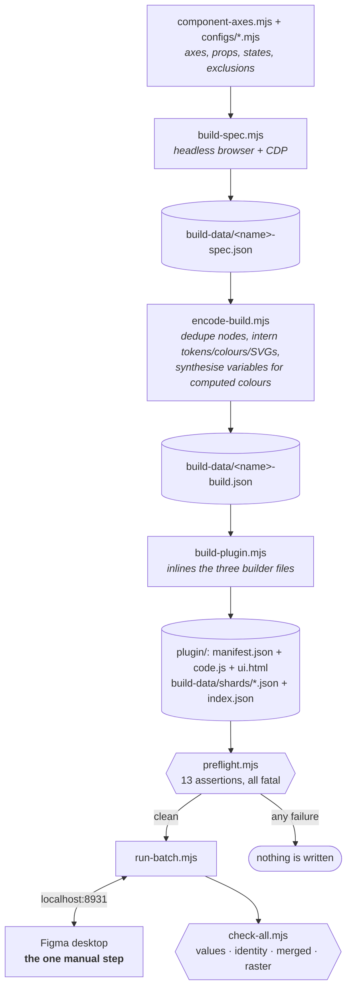
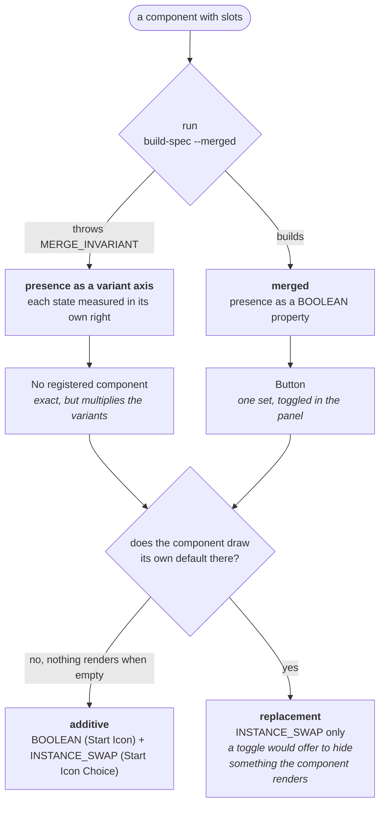

# Code → Figma component sync

Builds Figma component sets from the real rendered Dialtone components, then proves the result
matches. The codebase is the source of truth. Figma is the output.

Each variant is measured in light and dark. Button (560 variants), ButtonIcon (480), ButtonLink (560), Notice,
Banner, Collapsible and Loader are the components registered so far, built with the model
described here and checked clean. More are added in batches, each with its rebuild and check.

Not in CI. It needs a browser, a Figma PAT, and a scratch file that is nobody's source of
truth. Credentials live in `packages/figma-components-sync/.env` (`PERSONAL_ACCESS_TOKEN`,
`FILE_KEY`, `TOKENS_FILE_KEY`), mode 600, gitignored. See the package README for what each
one is.

## The one command

```bash
node sync-scripts/run-batch.mjs loader collapsible            # nothing depends on these
node sync-scripts/run-batch.mjs button button_icon button_link # Button's spinner is an instance of Loader
node sync-scripts/run-batch.mjs notice banner                 # their action is an instance of Button
```

A component that is an INSTANCE of another carries that component's variant ids, and building the
other clears its page, so a batch that holds both is refused. Build the target first, then what
uses it, in a separate run.

Everything except one click:

| Step | What |
| --- | --- |
| 1 | re-measure any spec older than the code that produces it |
| 2 | encode, shard, regenerate the plugin from `generic-builder.js` |
| 3 | preflight every payload, before anything is written |
| 4 | serve on `localhost:8931` and wait |
| **5** | **you: Figma desktop → Plugins → Development → Dialtone Components Sync → click Build** |
| 6 | write each returned set id into the configs and record its build fingerprint, **as it lands** |
| 7 | run `check-all` |

A Figma plugin only launches from the desktop UI, and the REST API is read-only for canvas
content. That is why this needs a plugin. Step 5 is the only manual part.

`--no-verify` stops after step 6. `--visual` also writes contact sheets. `--icons` builds the
icon library instead of components.

### What a run looks like

```mermaid
sequenceDiagram
    autonumber
    actor You
    participant RB as run-batch.mjs
    participant HTTP as localhost:8931
    participant PL as plugin (Figma desktop)
    participant CA as check-all.mjs

    RB->>RB: re-measure stale specs, encode, shard
    RB->>RB: preflight every payload
    Note over RB: a failure here stops the run<br/>before anything is written
    RB->>HTTP: serve shards, wait
    You->>PL: Plugins → Development → Dialtone Components Sync → click Build
    PL->>HTTP: GET /shards/index.json

    opt icon library present
        PL->>HTTP: GET icon shards
        PL->>PL: build icons (skips any whose content hash matches)
    end

    loop each component
        PL->>HTTP: GET its shards
        PL->>PL: build variants, combineAsVariants, add slot properties
        PL->>HTTP: POST /progress
        HTTP->>RB: recordBuilt: set id to config, fingerprint to built-from.json
        Note over RB: durable HERE, not at the end
    end

    alt run completes
        PL->>HTTP: POST /results
    else throws partway
        PL->>HTTP: POST /results with `aborted`
        Note over RB: says so plainly; what was built<br/>is already recorded
    end

    HTTP->>RB: report
    RB->>CA: verify (unless --no-verify)
    CA->>CA: refuses if any set cannot be vouched for
    CA-->>You: the table
```

The per-component `POST /progress` is what makes a partial run survivable. Before it, the
plugin posted once at the very end, so a throw on the twentieth component discarded the set
ids of the nineteen that had succeeded: the canvas held them and nothing on disk could name
them, which is indistinguishable from never having built them. `recordBuilt` is idempotent:
`/progress` calls it as each component lands and the final loop calls it again, so a plugin
too old to post progress behaves exactly as it did before.

## The pipeline



Provenance comes from the browser's own cascade rather than a reimplementation of it, which is
what makes the spec an independent reading instead of a restatement of our assumptions.

Three files are inlined into `plugin/code.js` by `build-plugin.mjs`:
`generic-builder.js` (component bodies), `icon-builder.js` (the icon library) and
`slot-properties.js` (component properties). Edit those, never `code.js`. All three are
hashed into the build fingerprint.

## What gets bound

Every number and colour the browser reports is compared. A *binding* is the stronger claim:
that Figma holds the same variable the stylesheet named, so the component follows the design
system rather than a copy of it taken on one afternoon.

Dialtone splits its numeric scales by role, and the sync follows whatever the CSS names:

| Scale | For | Reaches Figma as |
| --- | --- | --- |
| `--dt-spacing-*` | whitespace between things | `paddingTop` …, `itemSpacing`, `counterAxisSpacing` |
| `--dt-layout-*`, `--dt-icon-size-*` | the size of a box | `width`, `height`, `minWidth`, `minHeight` |
| `--dt-size-border-*` | stroke weights | `strokeTopWeight` … |
| `--dt-size-radius-*` | corners | `topLeftRadius` … |

The structural half arrived late and is worth understanding, because it is conditional. Width
and height are captured only when **the axis is pinned** and **the computed size already equals
the measured box**. The first because binding a hugging axis fixes it at the variable's value,
a size the component never declared; the second because it makes the binding inert, relabelling
a number the builder was going to write anyway. Neither condition adapts a number to fit
Figma's model, which is the standing rule.

Three things then disqualify a size token, each learned from a component that broke without it:

- **A floor or a clamp is doing the work.** `.d-keyboard-shortcut__icon` declares 12px and
  measures 12x16.8 because `min-block-size: 1lh` wins; Chip's icon declares 14 and measures 12
  because `max-inline-size` wins. Either way the declared token is not what rendered.
- **A percentage.** A Figma FLOAT variable holds pixels. `--dt-layout-100-percent` resolves to
  28 different values across DtAvatar, and one variable cannot be all of them.
- **A value that disagrees.** `bindNum` refuses any binding whose variable does not hold the
  measured number, and `paint()` does the same for colours.

A colour CSS computes (`color-mix()`, a relative colour, an oklch hue expression) has no
token to name, so a variable is **synthesised** into `Dialtone Derived (synthesised by sync)`
holding both measured modes. A literal would be right in one mode and wrong in the other.

## The checks

Each catches what the others structurally cannot.

| Check | Script | Answers | Blind to |
| --- | --- | --- | --- |
| values | `verify-components.mjs` | does Figma render like the browser, in both modes? | a binding to the wrong variable that happens to hold the right colour |
| identity | `audit-provenance.mjs` | is each property wired to the token the stylesheet names? | a value that was never bound at all |
| merged | `verify-components.mjs --merged` | is a set carrying its slots as component properties right in both states, slots off and on? | nothing else looks at the toggled state |
| raster | `visual-compare.mjs` | does it look right? | nothing numeric |

`check-all.mjs` runs the first three. Run the raster anyway: it found an empty image frame, 240
white icons, a double spinner and a solid purple disc, all of which passed every numeric check.

```bash
node sync-scripts/check-all.mjs                  # everything, slow
node sync-scripts/check-all.mjs button --light-only
node sync-scripts/check-all.mjs button --stale-ok # inspect a stale set deliberately
node sync-scripts/visual-compare.mjs button --set 1:2 --limit 8 --zoom 3
```

`check-all` refuses to run when it cannot tell which payload built a set, and prints the
`run-batch` line that fixes it. A pass over a stale canvas is worse than no pass: it reports on
work nobody is looking at, in the same words it uses for work that is current.

### Proving the checks work

```bash
node sync-scripts/negative-control.mjs button --list-fields   # cheap, no browser
node sync-scripts/negative-control.mjs button --variants 24
```

It parses `verify-components.mjs` for every field name the comparison can emit, perturbs each
one past tolerance against captured data, and asserts a finding with that name comes out. It
refuses to run if it cannot enumerate a field, and refuses if a field has no perturbation. The
inventory cannot drift from the engine in either direction.

That parser constrains how the engine is written, and should. A comparison loop has to be a
tuple array, `for (const [key, dom, fig] of [['topLeftRadius', …], …])`, because that is a
shape the parser reads. `Object.entries(SOME_MAP)` is not: it throws rather than guess, which
is the right failure, but writing it that way means the comparison ships with nothing testing
it.

When it was first made to run it found 18 comparisons that had never been perturbed, including
the two that had caught the largest bugs in the project. They worked. Nothing had established
that they would.

A perturbation can set `slotPass: true` when the comparison it targets only exists in a merged
build's filled sub-pass.

## Approaches that were tried and retired

The browser is the authority, not a reimplementation of it. Each of these was replaced once that
became clear, and none is kept in the repo. They are listed because the reasons are the design
rationale for what is here.

| Retired | Replaced by | Why it failed |
| --- | --- | --- |
| `css-provenance.mjs` | `cdp-provenance.mjs` | Reimplemented the CSS cascade. Every bug it had produced a plausible wrong token that no value-comparing verifier could see (H-9). `CSS.getMatchedStylesForNode` is the same engine that paints the pixels. |
| `extract-anatomy.mjs` | `build-spec.mjs` | Resolved tokens by reverse-looking-up values. 1,591 tokens collide on value, so it returned the right colour under a plausibly wrong name. |
| `rebind-button.mjs` | `audit-provenance.mjs` | A one-off Button audit against the old parser, so it could only ever confirm that parser's own answers. |
| `verify-figma-components.mjs` | `verify-components.mjs` | Button-only, root-plus-first-text-node, light-mode only. Its comment referred to a `forceState()` that was never written, so it reported 210/560 as complete (B-11). Actively misleading if run. |
| `probe-render.mjs` | `visual-compare.mjs` | Rasterised four hardcoded node ids from an early experiment. |
| `extract-disabled.mjs` | the synthesised-variable path (`dvars` in `encode-build.mjs`) | A one-off look at Button's computed disabled colours. The general path handles every computed colour rather than one component's. |
| `combine-variants.js` | `combineAsVariants` in `build-plugin.mjs` | Combined loose components into a variant set as a separate step, before all shards had landed. |
| `serve-build-data.mjs` | `run-batch.mjs` | Served shard payloads to the plugin. `run-batch` runs its own server inline so it can also catch the result POST and continue into verification. |

## Adding a component

1. Write the coordinate space. A simple component goes in `component-axes.mjs`; anything with
   real complexity gets `configs/<name>.mjs`. See `configs/README.md`.

   ```js
   {
     component: 'DtBadge', label: 'Badge', page: 'Badge',
     axes: { type: [...], kind: [...] },      // the prop space to sweep
     invalid: c => …,                          // OPTIONAL: combos that cannot exist
     props: c => ({ … }),                      // combo → Vue props
     variantName: c => `type=${c.type}, …`,    // THE authority for a variant's name
     pseudo: c => c.state === 'hover' ? ['hover'] : [],
     stateTarget: '.d-badge',                  // which element receives the state
   }
   ```

   `variantName` is the single authority. The checks use it to find the Figma variant, so never
   let a second name generator exist. Figma cannot store an empty variant value: map `''` to
   something like `'none'`.

   Everything except `component`, `axes`, `props` and `variantName` is optional, and the axes
   are expanded by `combosFor()` in `combos.mjs`. The measure and every check share it, so
   they cannot disagree about which variants exist.

2. `node sync-scripts/build-spec.mjs <name>` then `node sync-scripts/run-batch.mjs <name>`.
3. **Read the tree before trusting the count.** A component that renders nothing measures
   perfectly: the browser and Figma agree precisely about an empty box, and every numeric check
   passes. DtSelectMenu shipped 80 empty `<select>`s that way, DtFilterPill 32 bare chevrons,
   and DtSegmentedControl a 54x14 control holding three empty buttons. That last one because
   its items' `label` prop is the ARIA label and the visible text is the default slot. Pull the
   text out of `build-data/<name>-spec.json` and look at it.
4. Rasterise and look at it. Do not skip this on a new component.
5. Check the negative control still closes. `--list-fields` fails loudly if your component's
   shape exposed a comparison nothing perturbs.

## Slots

A slot's content does not render in the ordinary sweep, so nothing compares it. Two ways to
fix that, and which one a component needs is measurable rather than a judgement call.



The guard is the decision. A Figma property can hide a layer and swap an instance; it cannot
change a frame's padding or gap. So if the component moves its own spacing when the slot
fills, the merged model cannot express it and `--merged` refuses to build.

**Slot presence as a variant axis.** Add the slot names to `axes` as `[false, true]`, give the
config a `slots(combo)` function, and extend `variantName`. Each state is measured in its own
right. No merge, no hidden layers. Nothing registered uses it now: Button did, until its icons
became toggles to keep the set under Figma's 1,000-variant performance warning.

**Merged, presence as a BOOLEAN property.** `build-spec --merged` measures each variant twice
and emits one tree: shared nodes keep their base geometry, inserted subtrees carry their filled
geometry and a slot marker. The builder places the content hidden, and after
`combineAsVariants` attaches a `<Slot>` BOOLEAN (→ `visible`) to the SET, named like the
hand-built components ("Start Icon", with its swap "Start Icon Choice"). Button uses this form
(`merged: true` in its config, so it builds merged by default under its own name and page).

`button.less` cuts x-padding by 2px a side when an icon is present, which no component property
can reproduce, so the guard refuses a merged Button. A config can accept that divergence by name:
`slotSpacingDrift: { paddingLeft: 2, paddingRight: 2, itemSpacing: 2 }` lists the properties and the
largest difference (px) it accepts, and the merged set keeps the EMPTY render's spacing, so the
default state is exact and an icon state is up to 2px wider per side than the code. `build-spec`
prints each accepted divergence (`drift`), and the verifier records each one in the filled
sub-pass as an allowance. A larger difference, or any property not named, is still refused.

The axis form is exact and costs variants: Button as axes was 4,160, past Figma's warning at
1,000 ("Components with more than 1000 variants may experience performance issues").

There was a third way, retired: a `-slots` build that produced a second variant set holding the
filled render. It verified those nodes but a designer could not toggle anything, and once every
component moved to the merged or axis model it verified nothing at all. `cfg.slotPass` survives
it, naming the slots a merged build fills for its second render.

### Swap properties have one value per set

A layer bound to an `INSTANCE_SWAP` property shows that property's single value in **every
variant** of the set. Per-variant content and a panel property are mutually exclusive for the
same layer. Proven in both orderings: bind-then-swap and swap-then-bind.

So one swap property is exactly right where the content is identical in every variant (Badge
and Button both use `general/close`). Where it differs, binding every layer to one property made
DtNotice show a single glyph for all five kinds: 64 of 80 icons wrong, and no numeric check saw
it, because SVG internals are never compared shape-for-shape. Only the raster did.

So where the default differs, the slot gets **one swap property per default**, each bound only
to the layers that want it and named for the axis value that explains it: `Icon Choice ·
critical`, `Icon Choice · info`. `slot-properties.js` finds that axis (`splitByAxis`): the one
where every value maps to exactly one default, fewest values winning. When no single axis
separates the defaults (the icon depends on a combination), it falls back to one property with
one default, and `run-batch` prints how many layers that leaves wrong.

### Native slots for free-form content

Where a slot holds arbitrary content (Notice and Banner's `action`, Collapsible's `content`),
list it in the config's `nativeSlots` and it becomes a Figma `SLOT` node a designer can drop
anything into, instead of a swap property that can only pick one component. The measured
content stays inside the slot as the default. Two facts cost a build each:

- Same-named slots merge into one set-level slot property only when the slots exist **before**
  `combineAsVariants`, so the builder creates them per component first.
- The checks treat a `SLOT` node as transparent (one child is compared as that child) and skip
  a slot holding a declared exemplar, for the reason in the next section.

### Names follow the hand-built components

Every property a designer sees is human-friendly, Title Case with spaces, as in the docs-site
Combinator: "Link Kind", "Show Close", "Start Icon" (a visibility toggle) and "Start Icon Choice"
(the swap). A config keeps the Vue prop names (`linkKind`, `showClose`), because the browser side
needs them, and `component-axes.mjs` humanises them once by wrapping `variantName`, the one
function the builder, the verifier, the identity audit and the swap targets all use to name or
find a variant. Values are left as they are (`default`, `true`, `100`). The layers the
properties bind are named "Start Icon" with an inner `icon`. A set's description is generated
from its axes and slots (`describeSet` in `build-plugin.mjs`). Direction words stay logical
(`start`/`end`), as `.claude/rules/logical-naming.md` requires.

DtButton in Figma is three sets, in code one component:

- **DtButton** (560 variants): the labelled button, icons behind toggles (see above).
- **DtButtonIcon** (`configs/button_icon.mjs`, 480): the circular, icon-only button, `circle` with
  no label and one icon. `circle` is documented "use only with icon-only buttons", so it is a
  different design surface and has nothing to toggle.
- **DtButtonLink** (`configs/button_link.mjs`, 560): link mode, which pins `link: true` and has no
  `kind`, `importance`, icons or `circle`.

Folded into one set they were 4,720 variants. Split they are 1,600, each under Figma's
1,000-variant warning.

### The default variant comes from the code

The variant a designer gets on dropping the component in is the set's default variant, and Figma
makes that the TOP-LEFT variant on the canvas, not the first layer. It should be the one the
component renders with no props: each axis takes the component's own prop default
(`importance: 'primary'`, `size: 300`), `default` for a `state` axis and the first value
otherwise (`default-variant.mjs`, with the defaults read from the Vue runtime by the harness).
`build-spec` lays that variant out first so it lands top-left, the plugin reads back
`set.defaultVariant` and `run-batch` prints it, and the verifier compares each variant
property's default in the built set against the same function.

### Slot content is declared, not inferred

`slotContent(combo)` says what fills each slot. Without it every named slot received a
`DtIconClose`, so DtNotice's `action` was measured as a close icon.

```js
slotContent: c => ({
  action: {
    component: 'DtButton',
    props: { size: 200, importance: 'outlined', kind: c.important ? 'inverted' : 'muted' },
    text: 'Action',
    swapTo: { component: 'button', variant: { /* the full combo */ } },
  },
}),
slotDefaults: { icon: 'd-notice__icon' },   // the wrapper whose icon is the slot's default
```

`swapTo` names the Figma component a designer starts from, as a full variant combo so nothing
is inferred. `encode-build` resolves it against that component's existing set.

This content is an exemplar, not a contract. DtNotice's `action` is a bare slot whose doc
comment offers a link as its example, so the button is one plausible choice. The values pass
allows the exemplar's internals rather than comparing them, because DtNotice restyles its action
button (`notice.less`: `.d-btn { color: var(--notice-color-text) }`) and a standalone Button
instance cannot match that.

### A container's content is components

`label` fills the default slot with text, which is the whole content model for a Button and none
of it for a container. A slot spec can be one child, an array of them, or nested, and `default`
is a slot name like any other:

```js
slotContent: () => ({
  default: [
    { component: 'DtTab', props: { id: 'one', panelId: 'p1' }, text: 'One' },
    { component: 'DtTab', props: { id: 'two', panelId: 'p2' }, text: 'Two' },
  ],
}),
```

Without this, DtTextList, DtSegmentedControl and DtTabGroup could not be measured at all: an
empty container has no geometry worth syncing.

Check what rendered, not that rendering succeeded. DtSegmentedControlItem's `label` prop is the
ARIA label and its visible text is the default slot, so items given only `label` produced a
54x14 control containing three empty buttons, and every check passed, because the browser and
Figma agreed precisely about a component rendering nothing. That is B-104's shape and it will
keep recurring: the failure never looks like a failure.

## The icon library

617 components on an `Icons` page, built once:

```bash
node sync-scripts/run-batch.mjs --icons
```

Monochrome icons are flattened to a single vector named `Icon`. That is what makes an
instance-swap usable: Figma maps overrides across a swap by layer name, so a per-variant icon
colour survives the designer picking a different icon. 136 of the 139 clipPaths in the source
are full-box no-ops and are stripped first, because `figma.flatten` unions a clip mask into the
artwork instead of applying it. `alert-circle` flattened to a solid black square while every
structural check reported `1 Icon:VECTOR`.

Which fills count as themeable is parsed out of `dialtone-icons/gulpfile.cjs`, not copied. That
file's `fill="#000"` → `currentColor` rewrites are the definition.

A rebuild leaves an unchanged icon completely alone, keyed on a content hash in the component's
`description`. Replacing a component's children destroys every instance override pointing at
them, which silently decoloured every icon in the file: DtButton went from 0 findings to 4,480
with nothing about Button having changed (B-111). When an icon does change, the report says so.

## Guards

Each was added after the failure it prevents. The log has the evidence.

| Guard | Prevents |
| --- | --- |
| `encode-build` refuses a spec older than the code that produced it | encoding yesterday's measurements |
| `preflight.mjs`, 13 assertions, all fatal | a phantom 1×1 frame, a negative padding, a duplicate variant name, an empty variant value, a one-mode synthesised variable, an unfetchable image. Nothing here duplicates a later check: each catches something that would otherwise surface mid-build, after the page has been cleared, or not at all |
| build fingerprints over every shard and all three builder files | reporting on a set built from different data. Non-fatal: verifying a stale set deliberately is fine, not noticing is not |
| the `EXEMPT` coverage guard in `verify-components.mjs` | a property the harness reads but nothing compares |
| the negative control's bidirectional inventory | a comparison that exists and never fires |
| `figma-variants.mjs` throws if a subtree reaches the requested depth | reporting a truncated fetch as a defect in the work (B-101) |
| the identity audit reports a `childCount` mismatch instead of `Math.min`-ing the lists | pairing children past a structural divergence, then printing "N/N agree" (B-103) |
| the identity audit fails when it compared 0 bindings | a check that examined nothing reporting success |
| `figmaChildParts` is the only answer to "what are this node's Figma children" | the values and identity passes disagreeing about what a child is, which made the audit compare 0 bindings on DtInput and pass (B-105) |
| the harness provides no default slot for `label: ''` | an empty slot shadowing the component's own fallback, so 112 variants rendered a bare chevron and an empty select, and every check agreed (B-104) |
| `slotLayout` and `slotAxisSizing` | a toggle that reveals a layer without resizing the frame, so the icon lands on top of the label (B-108) |
| `slotToggle` and `slotSwap` | a slot layer nobody can reveal, or content nobody can change. Both geometrically identical to a correct one |
| `build-spec --merged` throws when a node vanishes between renders | modelling a replacement slot as a visibility toggle, which cannot express it |
| the icon content hash | a library rebuild wiping every instance override (B-111) |
| `check-all` refuses to run any pass when a set cannot be vouched for | reporting on a canvas that predates the payload. It used to run the passes and print the warning underneath them, which is how 3560 findings from a removed border fold read as a regression |
| `writeSetId` distinguishes "already this id" from "nothing matched" | a second, idempotent write throwing. Not a hypothetical: incremental reporting calls it twice per component by design |
| `bindNum` refuses a numeric binding whose variable disagrees with the measured literal | a bound variable overwriting the number underneath it |
| `paint()` refuses a colour binding whose variable holds a different colour, but only when EVERY mode is a concrete colour | a misattributed token painting the wrong colour. The mode qualifier is not fussiness: without it, a variable that aliases in one mode was compared against the other mode's value, and 64 correct bindings became literals that were wrong in dark |
| `run-batch` refuses a batch that rebuilds a swap target together with a component that swaps to it | the dependent's payload pointing at variant ids the rebuild just deleted. Build the target first, then the dependent in its own run |
| `run-batch` records a reported set id only for a component in the batch and only if it has the shape of a node id | the local server answers any origin, and the id is written into config source that `check-all` imports |
| `combosFor()` is the only expansion of a config's axes | the measure and the checks disagreeing about which variants exist. Five files had a verbatim copy; making `invalid` optional needed five edits and got one, and all ten checks died after a plugin run on work that was already correct |
| the one-variable-one-number sweep in `build-spec` | binding a token that resolves to different numbers in different places. `--dt-layout-100-percent` holds 28 distinct pixel values across DtAvatar |

If a check goes quiet, suspect the check. Several of this project's largest finding clusters
came from the measuring apparatus rather than the work: a runtime whose defaults differed from
the other runtime, a self-check whose expectation came from its own subject, a harness that
pinned the mode it was supposed to be varying, and a retry that covered every request but the
first.

Suspect a check that tests the WORDING of a condition rather than the condition. The stale-set
guard originally filtered its own messages for the string `REBUILD`, so "cannot tell whether
these sets are current", the strongest possible reason not to trust a pass, went straight
through it, twice. Any staleness blocks now, and `--stale-ok` covers the legitimate case of
inspecting a stale set deliberately.

**A new guard is a new thing that can be wrong, and it fails in the direction of the bug it
hunts.** Three written in a single day could not fire at all: two looked for a `%` that does
not survive the cascade, and one resolved a custom property through a lookup that cannot see
`:root`. A fourth fired correctly and broke sixty correct bindings, because it compared a
light measurement against a variable's dark mode. Prove a new guard fires on real data
before trusting it, or delete it. A guard nobody can show working is indistinguishable from
one that works, right up until the day it matters.

### The two APIs do not agree on names

This has cost seven separate bugs, every one of them the same shape: a read returns nothing,
the nothing becomes a zero or a null, and a correctly-built canvas is reported as broken. The
builder writes through the **plugin API**; the checks read through **REST**. Assume a name
that crosses that boundary is different until you have checked it in the API you are reading.

| What | Plugin API writes | REST reports |
| --- | --- | --- |
| corner radii, mixed | `topLeftRadius` … | `rectangleCornerRadii: [TL, TR, BR, BL]`, an array, and **no** `cornerRadius` |
| corner radii, uniform | `topLeftRadius` … | `cornerRadius`, and no array |
| stroke weights, mixed | `strokeTopWeight` … | `individualStrokeWeights: { top, right, bottom, left }` |
| stroke weights, uniform | `strokeTopWeight` … | `strokeWeight`, reported as 1 even on nodes carrying no strokes |
| size binding | `setBoundVariable('width', …)` | `boundVariables.size: { x, y }` |
| stroke-weight binding | `strokeTopWeight` | `boundVariables.individualStrokeWeights.BORDER_TOP_WEIGHT` |
| radius binding | `topLeftRadius` | `boundVariables.rectangleCornerRadii.RECTANGLE_TOP_LEFT_CORNER_RADIUS` |

Every container vanishes when its values agree, so a read tries the container, then the top
level, then zero, in that order. Any other order makes a uniform node read as unset.

REST also omits `layoutMode` and padding on a non-auto-layout frame, does not return
`description` on a component at all, reports an instance's stored `componentId` rather than the
value a bound property resolves to, and answers 200 with `nodes: {}` for a node it has not
finished indexing.

When a check disagrees with the build about geometry, read the node through the plugin API
before believing either. It settled two of these in minutes after hours of reasoning: the
canvas was right both times.

## Known limits

These appear in every run's allowances. A divergence nobody can see is the failure mode.

- SVG internals are imported whole, so they are not compared node-for-node. Their colour is.
- Computed colours (`color-mix()`, relative colour, an oklch hue expression) have no token, so
  they get a synthesised variable in `Dialtone Derived (synthesised by sync)` with both modes
  measured. A literal cannot follow the mode.
- A swap property shows one value across the variants bound to it, so a slot whose default
  differs gets one property per default. See above.
- A declared exemplar's internals are not compared against the render.
- Figma sets text slightly wider than Chrome (`SF Pro Text` against the system font Chrome
  renders): about 5% on bold, 3% on regular. Text width is reported, not failed. It shows as a
  tight gap where a fixed-width text frame overflows into it.
- An in-gamut colour that differs by dE00 <= 1.0 is accepted and recorded. The built CSS rounds
  an alpha-modified `oklch` token to two decimals (`oklch(0.91 0.09 165 / 0.45)`) while Figma
  holds the exact primitive (`oklch(0.9148 0.0923 165.26)`), a difference of 1-2 in 255. This is
  rounding, not gamut mapping: both colours are inside sRGB.
- A gradient paint is checked by its stops: the glyph colour must appear as one. DtLoader's
  opaque stops are bound to the glyph colour variable; the transparent ones stay literal,
  because a bound stop takes the variable's own alpha and would fill in the fade.
- In a merged build's filled sub-pass, REST reports a frame holding a hidden slot layer at its
  DEFAULT size, so its grown box is covered by `slotAxisSizing` instead of numerically.
- `insetEnd` is the one comparison the negative control cannot exercise. Its precondition needs
  `annotateAnchors`, which lives inside `verify-components`' CLI closure.
- `use_figma` has no `fetch`, so the image import is plugin-only.
- The identity pass fails on a DISAGREEMENT and on a zero denominator, **not** on
  "declared but unbound". A component can report `every binding matches the declared token`
  with several hundred declarations baked as literals. DtToggle does, with 540. Some of those
  look like exemptions not reaching pseudo-element nodes rather than real misses; unresolved,
  and written up in the follow-ups.
- Native controls are not represented inside their box. A `<select>`'s options live in a UA
  popup and measure 0×0, so the harness treats `<select>` as an opaque leaf. The options are
  still passed, because Chrome sizes the control to its widest one. `configs/input.mjs` excludes
  the native date, time, file and colour inputs for the same reason.

## Files

| Path | |
| --- | --- |
| `component-axes.mjs`, `configs/`, `combos.mjs` | what to render, and the one expansion of it |
| `build-spec.mjs`, `cdp-provenance.mjs`, `verify-harness/` | measure it |
| `encode-build.mjs`, `figma-mapping.mjs`, `icon-svg.mjs` | shape it for Figma |
| `generic-builder.js`, `icon-builder.js`, `slot-properties.js` | inlined into the plugin |
| `build-plugin.mjs`, `build-icon-library.mjs` | generate the plugin and its payloads |
| `preflight.mjs`, `run-batch.mjs` | orchestrate it. `run-batch` serves the shards itself |
| `verify-components.mjs`, `audit-provenance.mjs`, `check-all.mjs` | check it |
| `figma-variants.mjs` | fetch a set's variants with their full subtrees |
| `negative-control.mjs` | check the checks |
| `visual-compare.mjs` | look at it |
| `build-data/` | generated and gitignored: specs, payloads, shards, build fingerprints, contact sheets |

The guards table above carries the reasoning behind each check. When a line here looks
arbitrary, it was added after the failure it names.
